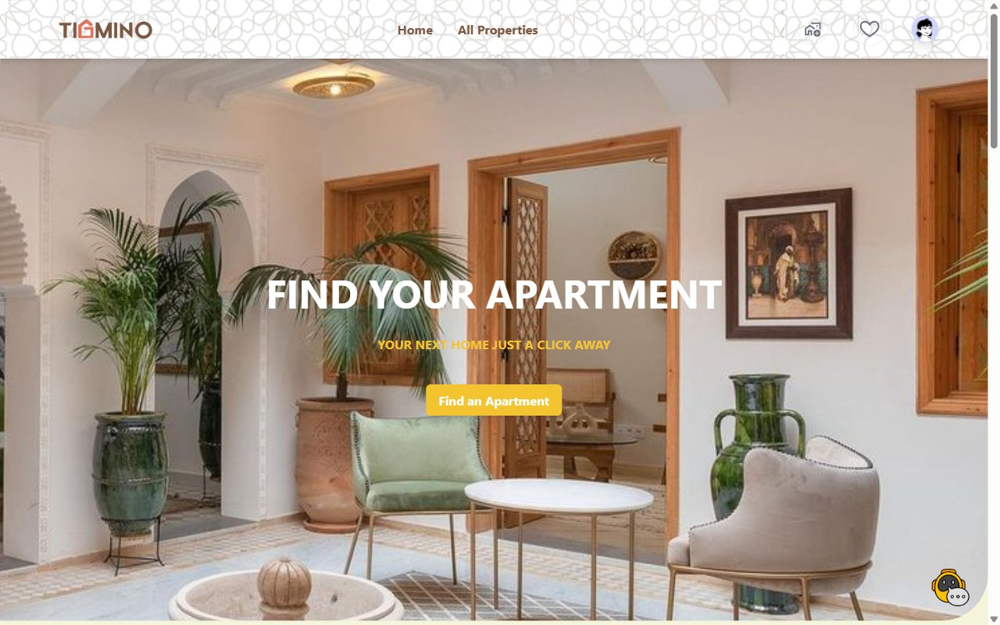
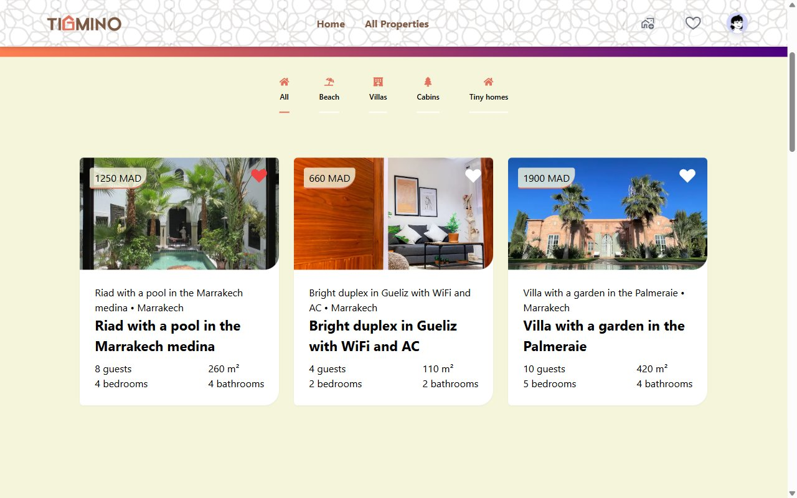
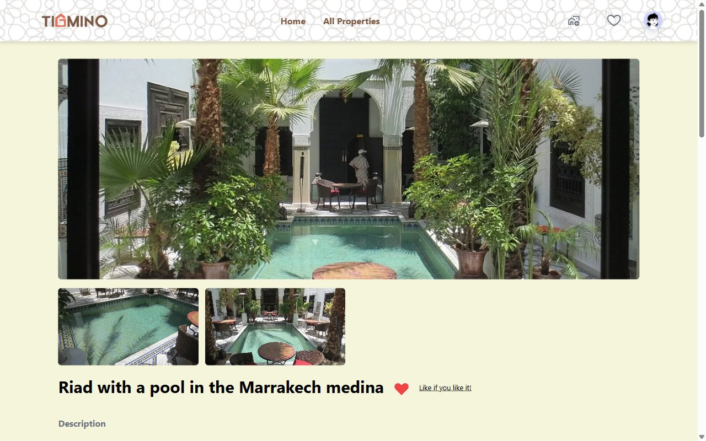
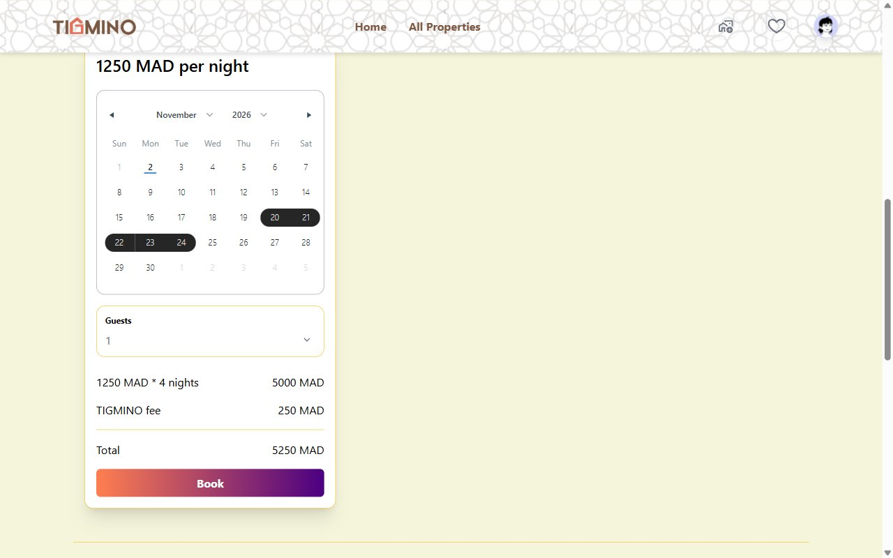
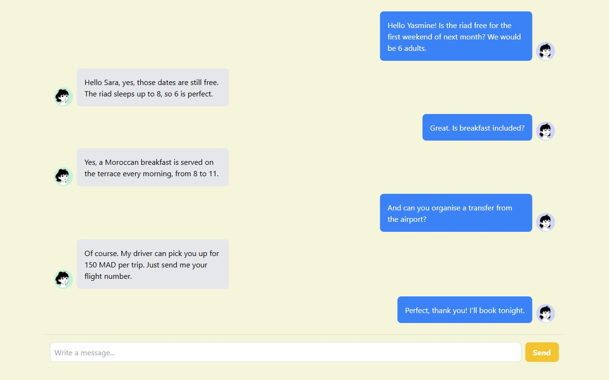
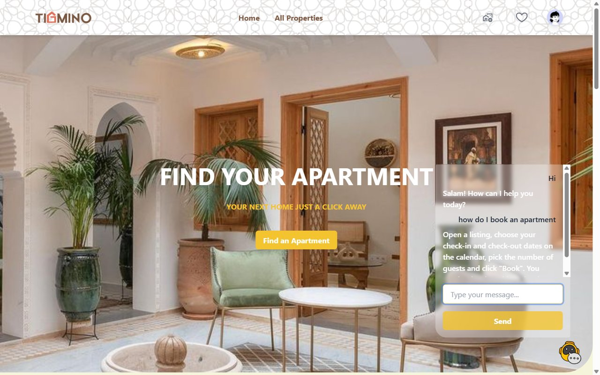
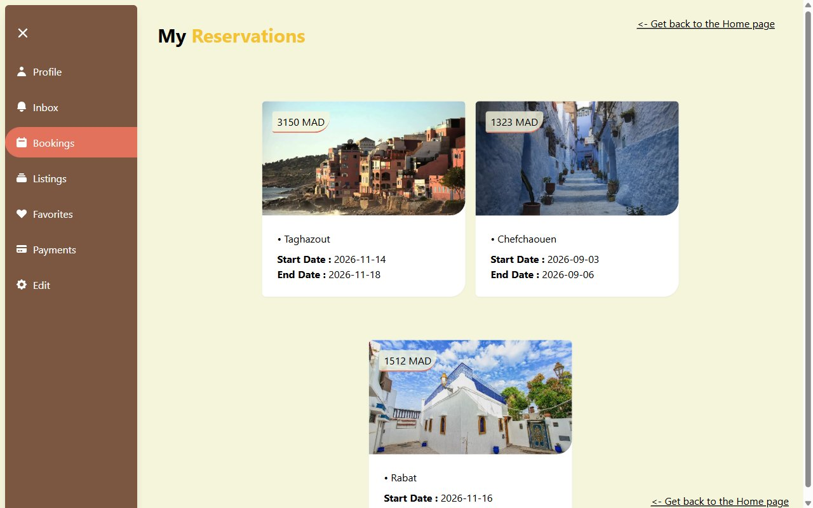
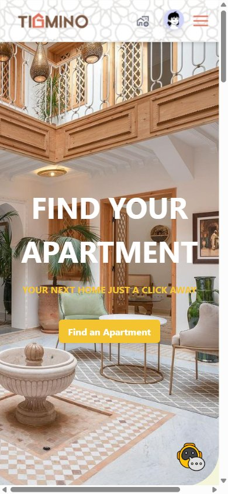
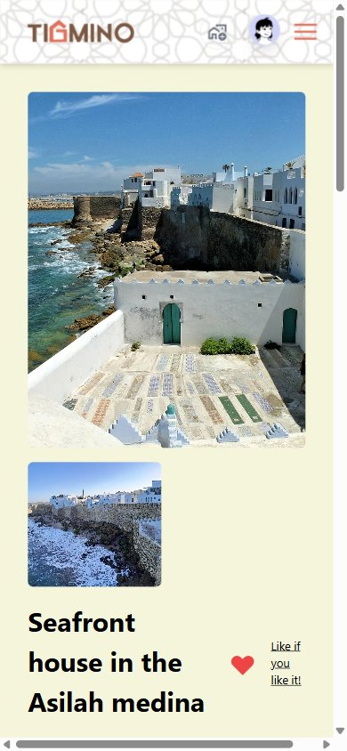
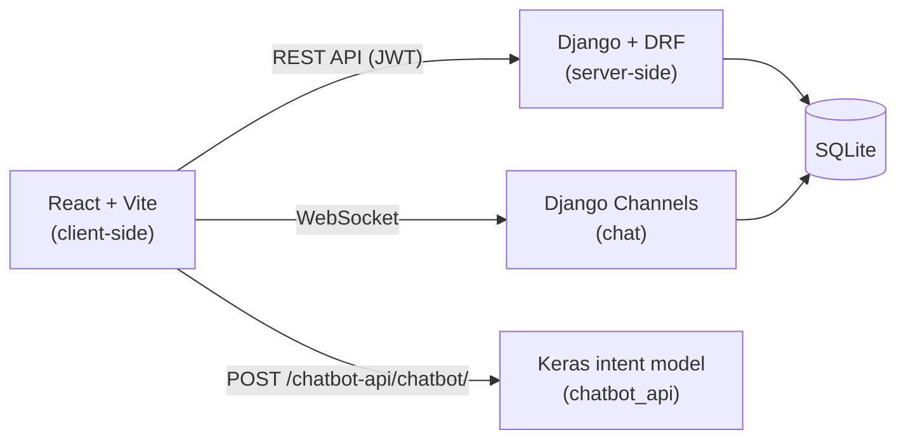

<div align="center">


**A house-rental platform for Morocco, with a chatbot and real-time messaging.**


[](LICENSE.md)

</div>

TIGMINO helps people find short-term housing in Morocco, with students in mind. Guests browse listings, book a stay, ask the chatbot quick questions and message the host in real time. Hosts publish and manage their own listings.

It was built as an academic mini-project in the Computer Engineering and Artificial Intelligence (GIIA) programme at ENSA Safi, Université Cadi Ayyad, in 2023/2024.

## Demo

https://github.com/user-attachments/assets/f6ec500d-afe1-4c97-9eca-1a03bc690d9f

In the video (1 min 35 s), a guest signs in, browses listings by category, books a house in Rabat, sees the booking in her reservations and messages the host, who replies in real time. She then greets the chatbot, asks it two questions and opens her dashboard. The video file is also in [docs/demo/tigmino-demo.mp4](docs/demo/tigmino-demo.mp4).

## Features

- Browse homes by category (beach, villas, cabins, tiny homes). Each listing has a photo gallery, a description, its size and how many guests it takes.
- Book a stay from a calendar. Before you confirm, the price breakdown shows the nights, a 5% TIGMINO fee and the total.
- Message the host in real time, over WebSockets (Django Channels).
- Ask the chatbot quick questions. It is a TensorFlow/Keras intent classifier served by the Django backend.
- Sign up and sign in with JWT, then manage your profile, bookings, favorites, inbox and listings from a dashboard.
- Become a host and publish your own listings.
- Admins manage users, listings, reservations and messages in the Django admin (Jazzmin theme).
- The layout works on phones as well as desktops.

## Screenshots

| Home | Listings |
|---|---|
|  |  |
| **Property** | **Booking** |
|  |  |
| **Messaging** | **Chatbot** |
|  |  |
| **Dashboard** | **On a phone** |
|  |   |

## How it works



- `client-side/`: React 18, TypeScript, Tailwind CSS and Zustand, built with Vite.
- `server-side/`: Django with Django REST Framework, dj-rest-auth and Simple JWT for authentication, and Channels with Daphne for WebSockets. Apps: `useraccount`, `property`, `chat`, `chatbot_api`.
- `deep-learning/`: the chatbot. `train_chatbot.py` (the same steps as the `chatigmino.ipynb` notebook) tokenizes the example questions in `Data/intents.json` and trains a small embedding, pooling and dense network to predict the intent. The reply is then picked from that intent's answers. The script copies the model, tokenizer and label encoder to `server-side/chatbot_api/model_info/`.

The chatbot knows 22 topics, such as booking, prices, payment, favorites and becoming a host. It is a small bag-of-words model, so it answers common phrasings well but can pick the wrong topic for unusual ones. To teach it more, add patterns or intents to `intents.json` and run `python deep-learning/train_chatbot.py`.

## Run it locally

Tested on Windows 11 with Python 3.12 and Node.js 22. The frontend expects the backend on `http://localhost:8000`.

### Backend

```bash
cd server-side
python -m venv .venv
.venv\Scripts\activate          # macOS/Linux: source .venv/bin/activate
pip install -r requirements.txt
python manage.py runserver
```

`requirements.txt` pins the versions the project was built with; newer `django-allauth` releases no longer accept its settings. Start the server from `server-side/`, because the chatbot loads its model files with relative paths.

### Frontend

```bash
cd client-side
npm ci
npm run dev
```

Then open http://localhost:5173.

### Demo data

The SQLite database in `server-side/` comes with 17 listings in 12 Moroccan cities, 12 users with profile pictures, bookings, favorites and conversations. Every account uses the password `tigmino-demo`:

| Account | Role |
|---|---|
| `sara@example.com` | Guest with bookings, favorites and three conversations |
| `yasmine@example.com` | Host of three listings in Marrakech |
| `nadia@example.com` | Host in Rabat and Casablanca |
| `admin@example.com` | Admin, for the Django admin at http://localhost:8000/admin/ |

The other hosts and guests (`karim`, `salma`, `youssef`, `omar`, `hassan`, `amina`, `ibrahim`, `lea`, `mehdi`) follow the same `name@example.com` pattern. To start again from the original demo data, run `python manage.py seed_demo --reset` in `server-side/`. The photo and avatar credits are in [docs/CREDITS.md](docs/CREDITS.md).

## Team

- Brahim EL HARCHE
- Oumar GOITA
- Wendyellé Abubakrh Alban NYANTUDRE

The project was first developed in [belharche/TigminoProject](https://github.com/belharche/TigminoProject).

## Citation

If you use, adapt or build on TIGMINO, please cite it and link to this repository as the source. GitHub's "Cite this repository" button (from [CITATION.cff](CITATION.cff)) gives the same reference in APA and BibTeX.

```bibtex
@software{nyantudre2024tigmino,
  author = {NYANTUDRE, Wendyellé Abubakrh Alban and EL HARCHE, Brahim and GOITA, Oumar},
  title  = {{TIGMINO}: A House-Rental Platform for Morocco with a Chatbot and Real-Time Messaging},
  year   = {2024},
  url    = {https://github.com/anyantudre/tigmino-house-rental},
  note   = {Academic mini-project, ENSA Safi, Université Cadi Ayyad}
}
```

Corresponding author: Wendyellé Abubakrh Alban NYANTUDRE (nyantudrealban@gmail.com).

## License

TIGMINO is released under the [PolyForm Noncommercial License 1.0.0](LICENSE.md). You can use, change and share the code for any noncommercial purpose, such as learning, teaching, research or personal projects. Commercial use needs permission from the authors. The demo photos and avatars keep their own licenses, listed in [docs/CREDITS.md](docs/CREDITS.md).
